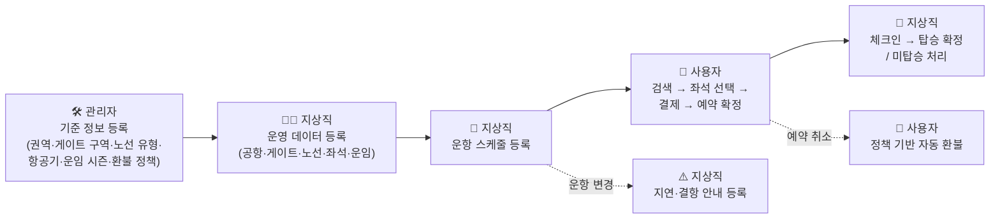
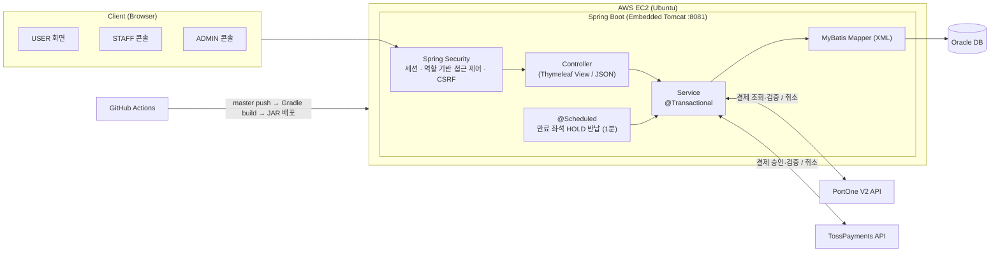
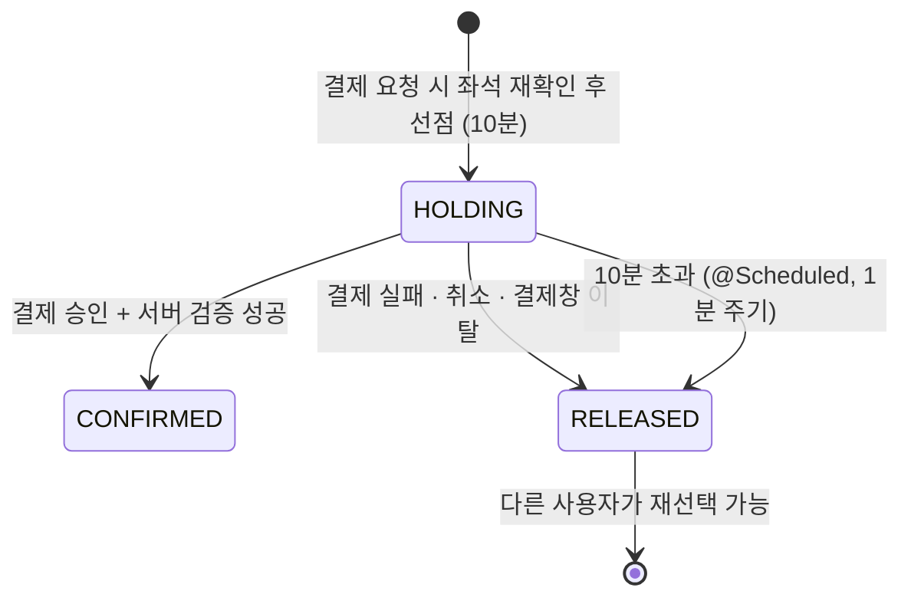

# ✈️ SkyRoute — 항공권 예매 · 운항 관리 통합 웹 서비스
> 사용자(USER) · 지상직(STAFF) · 관리자(ADMIN) 역할을 분리해
> **항공권 검색·예약·결제부터 운항 스케줄 관리, 체크인·탑승 처리까지** 하나의 흐름으로 연결한 Spring Boot 웹 애플리케이션입니다.


<br>
## 📌 목차
1. [프로젝트 개요](#-프로젝트-개요)
2. [기술 스택](#-기술-스택)
3. [시스템 아키텍처](#-시스템-아키텍처)
4. [주요 기능](#-주요-기능)
5. [핵심 구현 포인트](#-핵심-구현-포인트)
6. [데이터베이스 설계](#-데이터베이스-설계)
7. [트러블슈팅](#-트러블슈팅)
8. [팀 구성 및 역할](#-팀-구성-및-역할)
9. [프로젝트 구조](#-프로젝트-구조)
10. [실행 방법](#-실행-방법)
11. [회고](#-회고)
<br>
## 📖 프로젝트 개요
| 항목 | 내용 |
| --- | --- |
| **프로젝트명** | SkyRoute (항공사 예매 및 운항 관리 시스템) |
| **개발 기간** | 2026.06.10 ~ 2026.07.28 (약 7주) |
| **개발 인원** | 5명 (팀장 진민석) |
| **소속** | 쌍용강북교육센터 · AWS & CI/CD 기반 Java 클라우드 Full-Stack 개발자 양성과정 파이널 프로젝트 2조 |
| **기획 배경** | 실제 항공사의 운영 업무를 반영한 실무형 항공 예매 및 운항 관리 시스템의 필요성 |
| **목표** | 사용자·지상직·관리자 역할을 분리하여 항공권 예약부터 운항 관리, 체크인, 탑승까지 통합 지원하는 웹 서비스 구현 |
### 서비스 업무 흐름
실제 항공사 업무 순서를 그대로 따라가도록 설계했습니다.
**관리자**가 기준 정보를 만들고, **지상직**이 그 위에 운항 데이터를 쌓고, **사용자**가 예매하면 다시 **지상직**이 현장 처리를 합니다.

<br>
## 🛠 기술 스택
| 구분 | 기술 |
| --- | --- |
| **Language** | Java 17, SQL (Oracle PL/SQL), HTML, CSS, JavaScript |
| **Backend** | Spring Boot 3.4.6, Spring MVC, Spring Security 6, Spring Validation, Spring Mail, Lombok |
| **Persistence** | MyBatis 3.0.4 (XML Mapper), Oracle Database (ojdbc11), HikariCP |
| **Frontend** | Thymeleaf, Thymeleaf Layout Dialect, Thymeleaf Extras Spring Security, JavaScript (Fetch API), jQuery 3.7.1 |
| **Payment API** | PortOne V2 (카카오페이 · 카드결제), TossPayments (토스페이 · 계좌이체) |
| **Build** | Gradle |
| **CI/CD · Infra** | GitHub Actions → AWS EC2 (Ubuntu), 내장 Apache Tomcat |
| **Tools** | Eclipse, SQL Developer, ERDCloud, GitHub, Notion, Google Docs |
<br>
## 🏗 시스템 아키텍처

**배포 파이프라인** — `master` 브랜치에 push하면 GitHub Actions가 JDK 17로 Gradle 빌드를 수행하고, 생성된 JAR를 SSH로 EC2 서버에 업로드한 뒤 애플리케이션을 재시작합니다. SSH 키는 GitHub Secrets로 관리합니다.
<br>
## 🎯 주요 기능
### 🙋 사용자 (USER)
| 기능 | 설명 |
| --- | --- |
| **회원가입 · 로그인** | 아이디/이메일 중복 확인, BCrypt 비밀번호 암호화, 아이디·비밀번호 찾기(메일) |
| **항공권 검색** | 편도/왕복, 출발지·도착지·날짜·인원(성인/소아/유아)·좌석 등급 조건 검색, 항공편 상세 조회 |
| **탑승객 정보 입력** | 영문 성명·생년월일·성별·여권 정보 입력 |
| **좌석 선택** | 기재별 좌석 배치도에서 구간(가는 편/오는 편)별 좌석 선택 |
| **결제** | 카카오페이 · 카드결제(PortOne V2), 토스페이 · 계좌이체(TossPayments) |
| **예약 조회 · 취소** | 예약 상세 조회, 출발일 기준 환불 수수료 계산 후 자동 환불 |
| **마이페이지** | 내 정보·여권 정보 관리, 예약 현황, 관심 항공편 |
| **콘텐츠** | 공지사항, 이벤트(진행 중·종료·당첨자 발표), FAQ, 공항·기내 클래스·보유 항공기·유료 부가서비스 안내 |
### 🧑‍✈️ 지상직 (STAFF)
| 기능 | 설명 |
| --- | --- |
| **오늘 항공편 실시간 관리** | 금일 운항편 현황 집계, 운항 상태 수동 변경 (운항예정 → 탑승중 → 출발완료 → 도착완료 → 운항종료) |
| **운항 스케줄 관리** | 항공편 번호·노선·기재·출발/도착 게이트·시각으로 스케줄 등록·수정, soft delete 방식 취소 |
| **체크인 · 탑승 관리** | 항공편별 예약 확정 승객 조회, 체크인 → 탑승 확정 / 노쇼(NO_SHOW) 처리 |
| **지연 · 결항 안내** | 대상 항공편 검색 후 지연 시간·사유 등록, 등록과 동시에 항공편 운항 상태 변경 |
| **운영 기준 정보** | 공항 마스터, 게이트 구성, 운항 노선, 보유 항공기 상태(운항가능/정비중/퇴역), 기재별 좌석 자동 생성, 등급·시즌별 운임 |
| **콘텐츠 관리** | 공지사항(카테고리·공개 여부), 이벤트(배너 이미지·진행 상태·당첨자), FAQ(우선순위 설정) |
### 🛠 관리자 (ADMIN)
| 기능 | 설명 |
| --- | --- |
| **공항 · 노선 기준 정보** | 공항 권역(REGION), 게이트 구역(GATE_AREA), 노선 유형(단거리/중거리/장거리)과 기본 운임 |
| **기재 · 운임 · 환불** | 항공기 등록, 운임 시즌(성수기/비성수기 비율), 출발일 구간별 취소·환불 수수료 정책 |
| **계정 관리** | 가입 회원 상태 관리(정상/정지/휴면/탈퇴), 지상직(STAFF) 계정 발급·수정 |
| **전사 운영 통계** | 기간별 매출 통계(누적 매출·결제 건수·노선별 매출), 예약 통계(노선별 예약 비중) |
<br>
## 💡 핵심 구현 포인트
### 1. DB 제약으로 막는 좌석 중복 예약
동시에 같은 좌석을 잡으려는 요청을 애플리케이션 락(`synchronized`, `SELECT ... FOR UPDATE`) 대신 **Oracle 함수 기반 유니크 인덱스**로 막았습니다.
`HOLDING` 또는 `CONFIRMED` 상태인 티켓에만 `(항공편, 좌석)` 유일성을 걸었기 때문에, 해제(`RELEASED`)된 좌석은 다시 판매할 수 있고 경합이 생기면 `ORA-00001`로 한쪽만 성공합니다.
```sql
CREATE UNIQUE INDEX uq_ticket_active_seat ON TICKET (
    CASE WHEN hold_status IN ('HOLDING', 'CONFIRMED') THEN flight_id END,
    CASE WHEN hold_status IN ('HOLDING', 'CONFIRMED') THEN seat_id   END
);
```
- 별도의 좌석 재고 테이블 없이 `잔여 좌석 = SEAT − (CONFIRMED + 만료되지 않은 HOLDING 티켓)`으로 계산합니다.
- 유아(INFANT)는 좌석을 점유하지 않으므로 탑승객 행만 만들고 티켓은 만들지 않습니다.
### 2. 좌석 HOLD 10분 + 스케줄러 자동 반납

- 좌석 조회 쿼리에서 만료 시각을 함께 확인하므로, 스케줄러가 늦게 돌아도 만료된 좌석이 잘못 팔리지 않습니다.
- 스케줄러에서 예외가 나도 이후 실행이 멈추지 않도록 예외를 로깅 후 처리합니다.
### 3. 결제 서버 검증과 실패 경로 보존
- 클라이언트가 보낸 금액을 믿지 않고, **PortOne / TossPayments 서버에 결제 내역을 직접 조회**해 결제 금액·상태·주문번호를 예약 금액과 대조합니다.
- 검증에 성공해야만 결제 `PAID`, 예약 `CONFIRMED`, 좌석 `CONFIRMED`로 바뀝니다.
- 결제 실패 처리는 `@Transactional(propagation = REQUIRES_NEW)`로 분리했습니다. 호출한 쪽이 롤백되더라도 **좌석 반납(RELEASED) 기록은 반드시 커밋**되게 하기 위해서입니다.
- 티켓 금액과 예약 총액은 생성 시점의 **스냅샷**으로 저장하고 이후 수정하지 않습니다. 운임이 바뀌어도 이미 판매된 예약의 금액은 바뀌지 않습니다.
### 4. 정책 테이블 기반 취소·환불
- 출발일까지 남은 일수에 따라 수수료율을 적용하는 `REFUND_POLICY` 테이블을 두고, 환불 금액을 **DB 정책을 조회해 계산**합니다. (기본 설정 예: 출발 91일 이상 전 0% / 61~90일 30% / 15~60일 50% / 4~14일 70% / 0~3일 90%)
- 관리자가 화면에서 수수료율을 바꾸면 **코드 수정이나 재배포 없이** 즉시 반영됩니다.
- 환불액이 결제액과 같으면 `REFUNDED`, 수수료가 차감되면 `PARTIAL_REFUNDED`로 구분해 기록합니다.
### 5. 상태 기반 업무 규칙
각 상태값에 "무엇을 할 수 있는지"를 함께 정의해, 허용되지 않은 전이를 서비스 계층에서 차단합니다.
| 도메인 | 상태 |
| --- | --- |
| 회원 | `ACTIVE` · `SUSPENDED` · `INACTIVE` · `DELETED` (정지·탈퇴 계정 로그인 차단) |
| 예약 | `PENDING` → `CONFIRMED` / `FAILED`, `CONFIRMED` → `CANCELLED` |
| 결제 | `READY` → `PAID` / `FAILED` / `CANCELLED`, `PAID` → `PARTIAL_REFUNDED` / `REFUNDED` |
| 좌석 선점(티켓) | `HOLDING` → `CONFIRMED` / `RELEASED`, `CONFIRMED` → `CANCELLED` (예약 취소 시) |
| 체크인·탑승 | `NOT_CHECKED_IN` → `CHECKED_IN` → `BOARDED`, `NOT_CHECKED_IN` → `NO_SHOW` |
| 운항 | `SCHEDULED` · `BOARDING` · `DEPARTED` · `ARRIVED` · `DELAYED` · `CANCELLED` · `COMPLETED` |
- 체크인 대상은 **예약 `CONFIRMED` + 결제 `PAID`** 승객만 조회됩니다.
- 지연·결항 안내 등록과 항공편 상태 변경을 하나의 트랜잭션으로 묶어, 둘 중 하나만 반영되는 상황을 막았습니다.
### 6. 역할 기반 접근 제어와 보안
- Spring Security 세션 인증, `/admin/**`은 `ADMIN`, `/staff/**`은 `STAFF` 권한만 접근하도록 URL 단위로 분리했습니다.
- 비로그인 사용자는 항공권 검색·상세와 공지 조회까지만 허용하고, 예약 단계부터 로그인을 요구합니다.
- Fetch API 비동기 요청에도 CSRF 토큰을 검증하도록 구성했습니다.
- 비밀번호는 BCrypt로 암호화하고, DB 접속 정보와 결제 API 키 등 시크릿은 저장소에서 분리했습니다.
<br>
## 🗄 데이터베이스 설계
Oracle 기반 약 30개 테이블로 구성했습니다. 모든 PK는 `IDENTITY`, 기준 정보는 `is_active(Y/N)` 플래그로 비활성화하고, 운항 스케줄은 `is_deleted` soft delete로 이력을 보존합니다.
<!-- ERD 이미지를 docs/erd.png 로 올린 뒤 아래 주석을 해제하세요 -->
<!--  -->
| 영역 | 테이블 |
| --- | --- |
| **공통** | `MEMBER`, `NOTIFICATION` |
| **관리자 기준 정보** | `REGION`, `GATE_AREA`, `ROUTE_TYPE`, `AIRCRAFT`, `SEASON`, `REFUND_POLICY` |
| **지상직 운영 데이터** | `AIRPORT`, `GATE`, `ROUTE`, `SEAT_CLASS`, `SEAT`, `FARE`, `FLIGHT`, `FLIGHT_FARE`, `FLIGHT_NOTICE` |
| **콘텐츠** | `NOTICE`, `EVENT`, `FAQ` |
| **예약 · 결제** | `BOOKING`, `BOOKING_PASSENGER`, `SAVED_PASSENGER`, `TICKET`, `PAYMENT`, `REFUND` |
| **사용자 부가** | `FAVORITE_ROUTE`, `CHAT_INQUIRY`, `CHAT_MESSAGE` |
**설계 원칙**
- **기준 정보 → 운영 데이터 → 거래 데이터** 계층으로 나누고 FK로 참조 무결성을 보장
- `CHECK` 제약으로 상태값·금액(>0)·기간(종료일 ≥ 시작일)·수수료율(0~100) 등 도메인 규칙을 DB 레벨에서 강제
- 공항 시각은 UTC로 저장하고 공항별 IANA 타임존(`Asia/Seoul` 등)으로 변환해 표시
- 결제는 `PAYMENT`, 환불은 티켓 단위 `REFUND`로 분리해 부분 취소 이력을 추적
<br>
## 🔥 트러블슈팅
### 1. 항공 도메인 이해 보강을 통한 DB 테이블 구조 리팩토링
| | 내용 |
| --- | --- |
| **문제** | 초기 ERD의 `SEAT` 테이블에 행/열 컬럼이 따로 존재해 불필요한 데이터가 많았고, 좌석 등급별 운임 비율 같은 정보를 유연하게 관리할 독립 구조가 없었음 |
| **해결** | 행/열 컬럼을 제거하고 좌석 번호(예: `12A`) 중심으로 경량화. 좌석 등급을 `SEAT_CLASS` 테이블로 분리하고 FK로 연결. 화면에서는 DB 조회 대신 좌석 번호 규칙으로 좌석 배치도를 동적으로 렌더링 |
| **결과** | 가격 정책이 바뀌어도 테이블 구조 수정 없이 데이터 추가만으로 대응 가능, 불필요한 데이터 제거로 정합성 향상 |
### 2. 데이터 참조 구조 개선과 스냅샷 패턴으로 마이페이지 오류 해결
| | 내용 |
| --- | --- |
| **문제** | 마이페이지 사전 등록 탑승객(`SAVED_PASSENGER`)과 예약 탑승객(`BOOKING_PASSENGER`)이 강한 FK로 묶여, 원본 정보를 고치면 마이페이지 조회 불가·정합성 오류가 발생 |
| **해결** | 두 테이블 간 불필요한 FK를 해제하고, 예매 시점의 탑승객 정보를 독립된 데이터로 저장하는 **스냅샷 패턴** 적용. 예매 흐름 안의 중복 '정보 수정/저장' 로직도 정리 |
| **결과** | 원본 데이터(마이페이지)와 결과 데이터(예약 당시 정보)의 경계가 분명해져 조회 오류의 원인을 차단 |
### 3. 하드코딩된 환불 규정의 DB 정책 테이블 분리
| | 내용 |
| --- | --- |
| **문제** | 출발 D-Day 기준 단계별 수수료 계산이 코드 안의 `if-else`로 하드코딩되어, 정책이 바뀔 때마다 소스 수정과 재배포가 필요 |
| **해결** | `REFUND_POLICY` 테이블을 신설하고, D-Day 계산 후 DB 정책을 조회해 수수료를 계산하는 방식으로 전환 |
| **결과** | 관리자 화면에서 수수료율만 수정하면 서버 중단 없이 정책이 반영되는 구조 확보 |
<br>
## 👥 팀 구성 및 역할
| 이름 | 역할 | 담당 업무 |
| --- | --- | --- |
| **진민석** | 팀장 | 프로젝트 총괄 · DB 아키텍처 설계 및 ADMIN·STAFF 핵심 인프라 구축 · 최상위 기준 정보부터 현장 데이터까지 통합 설계 · 무결성 중심의 DB 제약 조건 설계 · 중앙 통제형 보안/계정 인프라 구축 |
| **정윤호** | 팀원 | <!-- TODO: 담당 업무 작성 --> |
| **엄상희** | 팀원 | 기획·요구사항 정의서 등 기준 문서 작성 · 팀 일정 및 아키텍처 설계 · 공지사항 구현 · PortOne V2 연동 결제/환불 시스템 구축 · 통합 테스트 및 디버깅 |
| **류림** | 팀원 | 예약/좌석 선택 프로세스 설계 및 구현 · 편도·왕복 구간별 예약 정보와 좌석 데이터 관리 · 좌석 HOLD 및 예약 상태 전환 로직 설계 · TossPayments 연동 결제·취소·환불 · 지상직 이벤트 관리와 사용자 이벤트 서비스 |
| **김경록** | 팀원 | Spring Security 기반 세션/권한(USER·STAFF·ADMIN) 접근 제어 설계 · Fetch API 비동기 통신 CSRF 토큰 검증 · MyBatis 연동 다중 등급(일등석·비즈니스·이코노미) 좌석 도면 동적 생성 · 관리자/지상직 마스터 데이터 분리 · `@Transactional` 기반 지연/결항-스케줄 상태 동기화 |
<br>
## 📂 프로젝트 구조
```
Skyroute
├── .github/workflows/deploy.yml        # GitHub Actions → EC2 배포
└── Skyroute
    ├── build.gradle
    └── src/main
        ├── java/kr/spring
        │   ├── config                  # SecurityConfig, AppConfig
        │   ├── admin                   # 관리자: 기준 정보 · 계정 · 통계
        │   ├── staff
        │   │   ├── basedata            # 공항 · 게이트 · 노선 · 좌석 · 운임
        │   │   ├── schedule            # 운항 스케줄
        │   │   ├── operation           # 체크인 · 탑승
        │   │   ├── delay               # 지연 · 결항 안내
        │   │   ├── content             # 공지 · 이벤트 · FAQ
        │   │   └── inquiry             # 고객 문의
        │   ├── member
        │   │   ├── booking             # 검색 · 좌석 · 예약 · 결제(payment) · HOLD 스케줄러
        │   │   ├── bookinglist         # 예약 조회 · 취소
        │   │   ├── security            # 인증 성공/실패 · 접근 거부 핸들러
        │   │   └── notice, schedule, content ...
        │   ├── main                    # 메인 화면
        │   └── util                    # 페이징 · 파일 · 검증 유틸
        └── resources
            ├── mapper/*.xml            # MyBatis SQL Mapper
            ├── templates               # Thymeleaf (layouts, fragments, thviews)
            ├── static/assets
            │   ├── css, js, images
            │   └── sql                 # base.sql(DDL) · 더미/테스트 데이터
            ├── application.yml
            └── data-config.yml         # DB 접속 정보 (로컬에서 직접 입력)
```
<br>
## ▶ 실행 방법
### 요구 사항
- JDK 17
- Oracle Database (XE 등)
### 1. 데이터베이스 준비
```sql
-- Oracle 계정 생성 후 아래 스크립트를 순서대로 실행
-- Skyroute/src/main/resources/static/assets/sql/base.sql   (테이블 · 제약 조건 · 인덱스)
-- Skyroute/src/main/resources/static/assets/sql/testData.sql (기준 정보 · 테스트 데이터)
```
### 2. 설정 파일 작성
`Skyroute/src/main/resources/data-config.yml`
```yaml
dataconfig:
  db-url: jdbc:oracle:thin:@localhost:1521:xe
  db-username: YOUR_USERNAME
  db-password: YOUR_PASSWORD
  rememberme-key: YOUR_KEY
```
`Skyroute/src/main/resources/application.properties` — 메일(SMTP)과 결제 테스트 키
```properties
spring.mail.host=...
imp.store_id=...           # PortOne V2 Store ID
imp.api-secret-v2=...      # PortOne V2 API Secret
imp.channel-card=...       # 카드 결제 채널 키
imp.channel-kakao=...      # 카카오페이 채널 키
```
### 3. 실행
```bash
cd Skyroute
./gradlew bootRun
# http://localhost:8081
```
> ⚠️ 결제는 PortOne · TossPayments **테스트 환경**으로 연동되어 있어 실제 결제는 발생하지 않습니다.
<br>
## 📝 회고
| Keep | Problem | Try |
| --- | --- | --- |
| 상태 기반의 꼼꼼한 비즈니스 로직 제어 | 복잡한 결제 취소 플로우 | 사용자가 몰려도 끊김 없는 서버 환경 구축 |
| 결제 실패·취소 시 좌석 선점을 자동 해제하는 트랜잭션 안전 설계 | 결제 API 연동에 따른 수동 환불 및 예외 테스트 시간 소요 | 화면 개발 방식(Vue.js)을 하나로 통일 |
| 화면 및 Service 계층의 이중 권한·상태 검증 | 프론트엔드 상태 관리의 분산 | 나중에도 수정하기 쉽도록 전체 코드 구조 개선 |
### 범위 외 (Out of Scope)
실제 항공사 운항 데이터 연동, 실결제 승인, 여권 검증·출입국 심사, 수하물 추적, 가격 자동 변동 알고리즘, 비회원 예매는 프로젝트 범위에서 제외했습니다.
